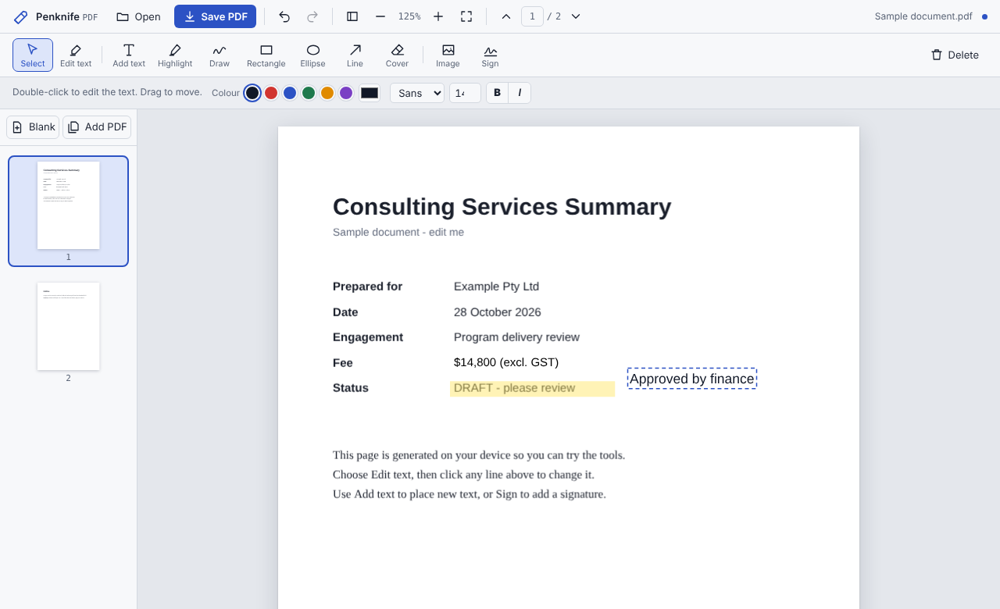

# Penknife PDF

A free PDF editor that runs entirely in your browser. Open a PDF, change its text, highlight, draw, sign,
and rearrange pages, then save. Your files never leave your computer: there is no server, no account, and no tracking.



> "Penknife" is a working name. Rename it freely (search for `Penknife` in `src/`).

## Use it

**Online, nothing to install:** https://nniimmeesshh-lab.github.io/penknife-pdf/

Your PDF stays on your computer. The page loads once and then works entirely locally.

**Download for offline use:**

1. Open the **Releases** page of this repository and download `penknife-pdf.html`. Or open the online version above and press `Ctrl+S` (`Cmd+S` on a Mac) to save the page.
2. Double-click the file. It opens in your browser and works without an internet connection.
3. Choose **Open**, pick a PDF, edit, then **Save PDF**. The edited copy downloads as `<name>-edited.pdf`; your original is untouched.

Works in current Chrome, Edge, Firefox and Safari on Windows, macOS, Linux and Chromebooks.

## What it does

| Area | Features |
| --- | --- |
| Reading | Zoom, fit to width, page thumbnails, select and copy text, password-protected files (view only) |
| Editing text | Click any line of existing text and retype it. The original is covered and your text is placed over it in a matching font |
| Adding | Text boxes, highlight, freehand draw, rectangle, ellipse, line and arrow, images, drawn signature |
| Pages | Rotate, delete, drag to reorder, insert blank pages, merge in another PDF |
| Everything | Undo and redo, move and resize, keyboard shortcuts, light and dark themes |
| Output | Saves a normal PDF. Text stays real text; Hindi and other scripts the standard PDF fonts cannot encode are saved as an image of the text |

Keyboard shortcuts: `V` select, `E` edit text, `T` add text, `H` highlight, `P` draw, `R` rectangle,
`O` ellipse, `L` line, `C` cover, `I` image, `S` signature, `Ctrl+Z` / `Ctrl+Shift+Z` undo and redo,
`Ctrl+S` save, `Ctrl+O` open, `+` / `-` zoom, `Delete` remove the selected item.

## Build it yourself

Needs Node.js 18 or newer. The build writes `dist/penknife-pdf.html` and a copy at `docs/index.html`, which is what GitHub Pages serves.

```
npm install
npm run build
```

Open `dist/penknife-pdf.html` in Chrome, Edge, Firefox or Safari. Pre-built copies can be attached to a GitHub release.

## How it works

- [pdf.js](https://github.com/mozilla/pdf.js) draws pages and finds the text.
- [pdf-lib](https://github.com/Hopding/pdf-lib) writes the edited PDF. If you only annotate, the original file is
  edited in place, so forms, bookmarks and metadata survive. If you reorder, delete, insert or merge pages, a new PDF is assembled from the pages.
- Annotations live in page coordinates (points, top-left origin) and are mapped to PDF space on save,
  including pages that carry their own `/Rotate`. See `src/js/04-save.js`.
- `build.mjs` inlines both libraries and the app into one HTML file. No bundler is needed.

```
src/
  styles.css        interface styles (light and dark)
  body.html         markup
  js/01-core.js     state, history, icons, helpers
  js/02-render.js   loading, page rendering, thumbnails, overlay
  js/03-tools.js    tools, pointer handling, text editing, page operations
  js/04-save.js     writing the PDF
  js/05-main.js     start-up and keyboard
build.mjs           produces dist/penknife-pdf.html
tests/              Playwright tests
```

## Tests

```
npx playwright install chromium
npm run build
npm test                      # smoke test: open, edit text, annotate, rotate, save
node tests/features.mjs       # undo/redo, resize, page operations, merge, signature, image
```

The tests open the built file, drive the interface with the mouse and keyboard, and check the saved PDFs.

## Known limits

- **Cover is not redaction.** Edited text and the Cover tool hide the original with a white box. The original
  text is still inside the file and can be extracted. Do not use this to remove sensitive information.
- Edited text is matched to Helvetica, Times or Courier (regular, bold, italic). The original font is not reused, and text colour is assumed to be black.
- Password-protected PDFs can be viewed but not saved after editing.
- Interactive form fields are preserved when you annotate, but cannot be filled in yet.
- Only horizontal text can be edited. Rotated and vertical text is skipped.
- Scanned pages are images; there is no OCR.
- Images that use JPEG 2000 or JBIG2 may not display, and some PDFs that rely on non-embedded fonts will show substitute fonts.

## Ideas for contributions

Form filling, OCR, text search, true redaction (flatten to image), embedding Unicode fonts so Hindi stays selectable text,
page extraction and split, a print-to-PDF flow, and an installable offline version (PWA).

## License

MIT, see `LICENSE`. Bundled libraries keep their own licenses, see `THIRD_PARTY_NOTICES.md`.
